<div align="center">



<a href="https://git.io/typing-svg">
  
</a>

<p>
  
  
</p>

</div>

## 🍑 Sobre mí

```js
const manuela = {
  rol: ["Frontend Developer", "UX/UI Designer"],
  ubicacion: "Medellín, Colombia 🇨🇴",
  diseño: ["investigación de usuarios", "wireframes", "prototipos en Figma", "design systems"],
  meGusta: ["interfaces bonitas", "animaciones suaves", "design systems", "accesibilidad"],
  aprendiendo: ["accesibilidad (WCAG)", "Node.js / APIs REST", "MongoDB", "Docker", "testing (Playwright)", "Claude Code"],
  cafe: true,
};
```

<details>
<summary><b>🌍 English version (click me)</b></summary>
<br/>

```js
const manuela = {
  role: ["Frontend Developer", "UX/UI Designer"],
  design: ["user research", "wireframes", "Figma prototypes", "design systems"],
  location: "Medellín, Colombia 🇨🇴",
  loves: ["beautiful interfaces", "smooth animations", "design systems", "accessibility"],
  learning: ["accessibility (WCAG)", "Node.js / REST APIs", "MongoDB", "Docker", "testing (Playwright)", "Claude Code"],
  coffee: true,
};
```

I design and build user experiences: from research and wireframes in Figma to fast, accessible and pixel-perfect interfaces. 💜
</details>

## 🛠️ Stack

<div align="center">

**Frontend**<br/>


**Estilos · Styling**<br/>


**Back-end y herramientas · Back-end & tools**<br/>


**Diseño · Design & tools**<br/>


</div>

## 💼 Dónde trabajo · Where I work

<table align="center">
<tr>
<td width="120" align="center">
  <a href="https://github.com/UT-LIME-UdeA"></a>
</td>
<td>

### [LIME · UdeA](https://github.com/UT-LIME-UdeA)
Diseño UX/UI y desarrollo frontend en la **Universidad de Antioquia** 🎓<br/>
<sub>UX/UI designer & frontend developer at Universidad de Antioquia</sub>

**🔬 PATHSYS** — plataforma web para la gestión de un laboratorio de patología: dashboards de estadísticas, gráficas interactivas, filtros y roles de usuario.<br/>
<sub>Web platform for a pathology lab: stats dashboards, interactive charts, filters and role-based access.</sub>


</td>
</tr>
</table>

## 📊 Stats

<div align="center">


<br/>

</div>

## 📫 Hablemos · Let's talk

<div align="center">
<a href="mailto:TU_CORREO"></a>
<a href="https://linkedin.com/in/TU_LINKEDIN"></a>
<a href="https://TU_PORTAFOLIO"></a>


</div>
